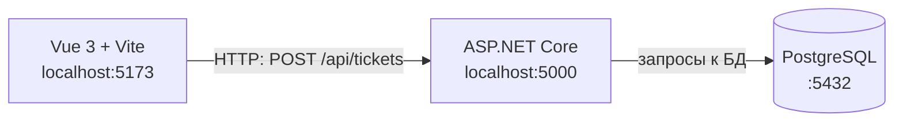

# Архитектура

## Схема из трёх узлов



архитектура web-ИС семестра

## Текстовая версия схемы

```text
Vue 3 + Vite             ASP.NET Core              PostgreSQL
localhost:5173  ───────► localhost:5000  ───────► :5432
                  HTTP                    запросы к БД
```

архитектура web-ИС семестра

## Роли узлов

| Узел | Порт | Что делает |
|---|---|---|
| Vue 3 + Vite | 5173 | рисует экран и отправляет HTTP-запросы к API |
| ASP.NET Core | 5000 | проверяет правила и права ролей, работает с базой данных |
| PostgreSQL | 5432 | хранит заявки, сетевые объекты и пользователей |

## Почему браузер не обращается к PostgreSQL напрямую

Прямой стрелки от браузера к базе данных нет. Если бы клиент обращался к базе напрямую, он получал бы доступ ко всем данным и обходил бы правила сервера: проверку роли (диспетчер или исполнитель), допустимые переходы статусов и формирование `id` и `number`. Поэтому всё общение идёт через ASP.NET Core, а права проверяются на стороне сервера (NFR-03 из ЛР1).