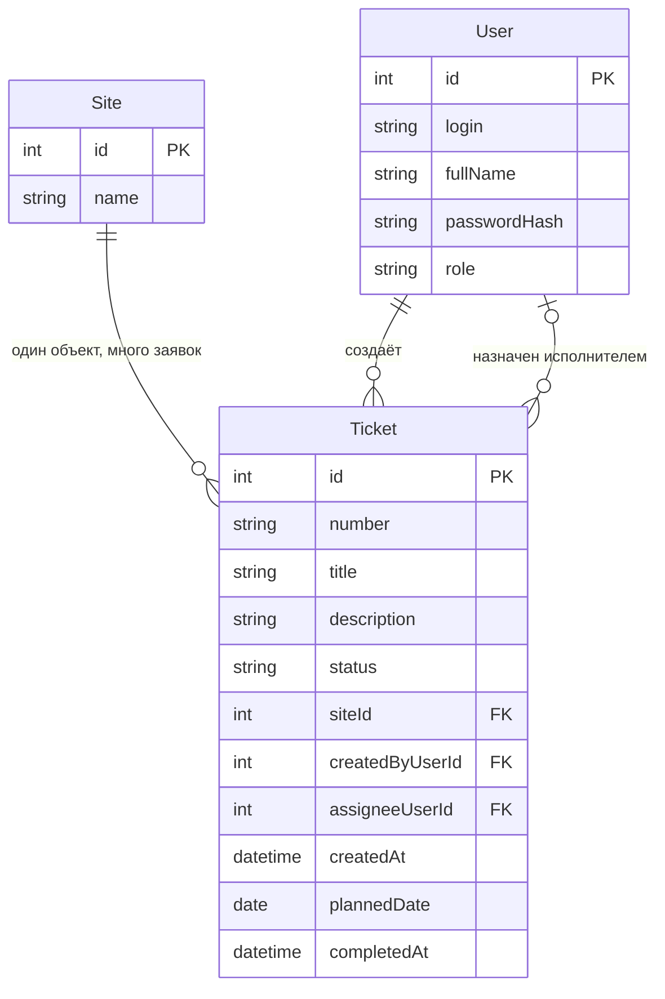

# Модель данных

## Словарь проекта

| Термин курса | Термин моей темы | Имя в коде |
|---|---|---|
| Ticket | заявка на контроль этапа реконструкции | Ticket |
| Site | сетевой объект | Site |
| User | пользователь (диспетчер / исполнитель) | User |

В документах используется один термин: «заявка» (Ticket).
В ЛР1 поле исполнителя называлось `executorId`; с ЛР2 оно называется `assigneeUserId`.

## Сущности

### Ticket (заявка)

| Поле | Тип | Ключ | Комментарий |
|---|---|---|---|
| id | int | PK | машинный идентификатор |
| number | text | — | человекочитаемый номер, например REC-0001, уникальный |
| title | text | — | заголовок, обязательно |
| description | text | — | описание |
| status | text | — | New, InProgress, Closed, Cancelled |
| siteId | int | FK → Site.id | обязательно |
| createdByUserId | int | FK → User.id | диспетчер, создавший заявку |
| assigneeUserId | int, NULL | FK → User.id | при создании пусто |
| createdAt | timestamp | — | дата создания |
| plannedDate | date, NULL | — | плановый срок |
| completedAt | timestamp, NULL | — | фактический срок |

### Site (сетевой объект)

| Поле | Тип | Ключ |
|---|---|---|
| id | int | PK |
| name | text | — |

### User (пользователь)

| Поле | Тип | Ключ | Комментарий |
|---|---|---|---|
| id | int | PK | |
| login | text | — | уникальный |
| fullName | text | — | |
| passwordHash | text | — | |
| role | text | — | Dispatcher или Executor |

## ER-диаграмма

Связи словами:
- один сетевой объект связан со многими заявками (1:N);
- один пользователь создаёт много заявок (1:N);
- один пользователь может быть назначен исполнителем многих заявок (1:N);
- у новой заявки исполнитель может отсутствовать (`assigneeUserId` пустой).

## Проверка 3НФ

Название сетевого объекта хранится в сущности Site один раз. Ticket содержит только внешний ключ siteId. При переименовании сетевого объекта меняется одна строка, поэтому текст названия не дублируется в заявках. Данные пользователя (ФИО, логин) тоже хранятся только в User, а Ticket ссылается на них по id.